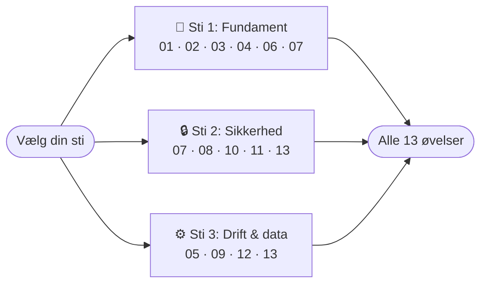

# PostgreSQL sikkerhed - øvelsessamling

En samling af 13 øvelser til undervisning i PostgreSQL-administration, -optimering og -udvikling. 


## Hvorfor lige PostgreSQL?

**PostgreSQL er i 2026 en af verdens mest populære og udbredte databaser blandt softwareudviklere.** Ifølge [Stack Overflow Developer Survey 2026](https://survey.stackoverflow.co/2026/technology/data/databases) er PostgreSQL den mest anvendte databaseteknologi blandt undersøgelsens 12.061 respondenter.

De mest anvendte databaseteknologier i undersøgelsen er:

| Database | Andel af udviklere |
|---|---:|
| **PostgreSQL** | **57,9 %** |
| SQLite | 42,1 % |
| MySQL | 35,1 % |
| Redis | 28,3 % |
| Microsoft SQL Server | 27,1 % |
| MariaDB | 20,3 % |
| MongoDB | 19,0 % |
| Oracle | 9,4 % |

Respondenterne kunne vælge flere teknologier. Undersøgelsen viser udviklernes anvendelse, ikke databasernes globale markedsandele.

### Hvorfor er PostgreSQL populær?

PostgreSQL kombinerer en række egenskaber, som gør databasen relevant til både klassiske virksomhedssystemer og moderne AI-applikationer:

- **Open source og digital suverænitet:** Gratis, en permissiv open source-licens og mulighed for at drive databasen på egne servere eller hos forskellige cloudleverandører. [PostgreSQL License](https://www.postgresql.org/about/licence/)
- **Robusthed og skalerbarhed:** ACID-transaktioner, replikering, backup og recovery. Med den rigtige arkitektur kan PostgreSQL understøtte meget store produktionsmiljøer. [PostgreSQL Documentation](https://www.postgresql.org/docs/current/)
- **AI og moderne datatyper:** PostgreSQL understøtter blandt andet JSONB og kan udvides med [pgvector](https://github.com/pgvector/pgvector), der tilbyder vektorsøgning til eksempelvis AI-applikationer og semantisk søgning.
- **Avanceret sikkerhed:** Rollebaseret adgangskontrol, Row-Level Security, stærk autentifikation, TLS og omfattende muligheder for logging og auditing. [PostgreSQL Security](https://www.postgresql.org/docs/current/ddl-rowsecurity.html)
- **Modent økosystem:** Databaseværktøjer, drivere, udvidelser og integrationer med stort set alle almindelige programmeringssprog og udviklingsplatforme.

### PostgreSQL i nogle af verdens største platforme

PostgreSQL bruges ikke kun af mindre virksomheder og udviklere. Det indgår også i infrastrukturen bag nogle af verdens største digitale tjenester.

- **ChatGPT / OpenAI:** I januar 2026 beskrev OpenAI, hvordan PostgreSQL understøttede centrale dele af ChatGPT og OpenAI's API-platform med 800 millioner brugere og millioner af databaseforespørgsler i sekundet. Det krævede blandt andet omfattende optimering og næsten 50 læsereplikaer. [OpenAI Engineering, 2026](https://openai.com/index/scaling-postgresql/)
- **Reddit:** Reddit beskrev i juli 2025, hvordan PostgreSQL blev anvendt til lagring af platformens kommentardata, mens Memcached og Redis håndterede andre opgaver. [Reddit Engineering, 2025](https://www.reddit.com/r/RedditEng/comments/1mbqto6/modernizing_reddits_comment_backend_infrastructure/)

PostgreSQL er ikke nødvendigvis den hurtigste database til alle opgaver, og store systemer bruger ofte flere forskellige databaseteknologier. Men dens alsidighed, stabilitet, åbne arkitektur og store udbredelse gør den til et stærkt valg.

### Hvorfor lærer vi databasesikkerhed med PostgreSQL?

Vi bruger PostgreSQL i systemsikkerhed, fordi vi kan arbejde praktisk med **grundlæggende sikkerhedsprincipper, der også gælder for andre DBMS'er**, eksempelvis MySQL, MariaDB, Microsoft SQL Server, Oracle og til dels NoSQL-databaser som MongoDB.

Vi kommer blandt andet til at arbejde med:

- **Autentifikation:** Hvem må forbinde til databasen? Stærke adgangskoder, SCRAM-SHA-256 og adgangsregler i `pg_hba.conf`.
- **Autorisation og Least Privilege:** Hvad må forskellige brugere og services gøre? Roller, rettigheder, `GRANT`, `REVOKE` og Row-Level Security.
- **Netværkssikkerhed:** Begrænsning af adgang, krypterede forbindelser med TLS og reduktion af angrebsfladen.
- **Hardening og baseline security:** Sikring af standardkonfigurationen med udgangspunkt i anerkendte anbefalinger og sikkerhedsbenchmarks.
- **Logging og overvågning:** Registrering og analyse af databaseaktiviteter, fejl og mistænkelig adfærd.
- **Backup og recovery:** Sikring af dataintegritet, tilgængelighed og mulighed for at genskabe data efter fejl eller angreb.
- **SQL Injection:** Forståelse af angreb mod databaser og forebyggelse gennem blandt andet parameteriserede forespørgsler.

**Målet er ikke at uddanne jer til PostgreSQL-administratorer. Målet er at lære jer at tænke og arbejde systematisk med databasesikkerhed.**

Når I kan analysere en usikker PostgreSQL-installation, identificere sårbarheder, vurdere risici, implementere modforanstaltninger og dokumentere jeres arbejde, har I opnået færdigheder, der i høj grad kan overføres til andre databasesystemer.

Kommandoer, konfigurationsfiler og sikkerhedsfunktioner varierer mellem DBMS'er, men de grundlæggende principper er stort set de samme: **beskyt data, begræns adgang, registrer hændelser, sikr tilgængelighed, og verificér at sikkerhedsforanstaltningerne faktisk virker.**

Det er disse generelle kompetencer, vi træner.

## Du skal bruge
- Docker Desktop eller Podman
- Minimum 8 GB RAM anbefalet

## Øvelser

| Nr | Titel | Tier | Tid | Docker | Beskrivelse | Sikkerhedsaspekt |
|----|-------|---------------|-----|--------|-------------|------------------|
| 01 | [Benchmarking og hukommelseskonfiguration med pgbench](./oevelser/01-pgbench-tuning/OEVELSE.md) | Tier 1 · Begynder | 30-45 min | 🐳 | Performance-tuning med pgbench og konfiguration | CIA-A · ressource/DoS |
| 02 | [Statistik og ANALYZE til bedre query-planer](./oevelser/02-pg-stats-analyze/OEVELSE.md) | Tier 1 · Begynder | 30 min | 🐳 | ANALYZE og query-planlægning | — fundament |
| 03 | [Læsning af eksekveringsplaner med EXPLAIN](./oevelser/03-explain-analyze/OEVELSE.md) | Tier 1 · Begynder | 45 min | 🐳 | EXPLAIN, seq scan, nested loop, hash join | — fundament |
| 04 | [Indekser: hurtigere læsning, langsommere skrivning](./oevelser/04-index-tradeoff/OEVELSE.md) | Tier 1 · Begynder | 45 min | 🐳 | Indekser, læse- vs skriveperformance | CIA-A · skrive-DoS |
| 05 | [Normalisering til 3NF og bevidst denormalisering](./oevelser/05-normalization-3nf/OEVELSE.md) | Tier 2 · Øvet | 60 min | 🐳 | Normalisering, denormalisering | CIA-I · dataintegritet |
| 06 | [Overvågning af forbindelser og queries med pg_stat_activity](./oevelser/06-pg-stat-activity/OEVELSE.md) | Tier 2 · Øvet | 45 min | 🐳 | Overvågning af aktive forbindelser | NIST AU · overvågning |
| 07 | [Logging og audit af databaseaktivitet](./oevelser/07-logging-audit/OEVELSE.md) | Tier 1 · Begynder | 45 min | 🐳 | PostgreSQL-log, log_statement, fejlfinding | NIST AU-2/AU-9 · audit & log |
| 08 | [Brugeradministration og rettigheder](./oevelser/08-roles-grants-rls/OEVELSE.md) | Tier 2 · Øvet | 45 min | 🐳 | Roller, GRANT/REVOKE, Row Level Security | NIST AC-3/AC-6 · least privilege, RLS |
| 09 | [Transaktioner, isolation og savepoints](./oevelser/09-transactions/OEVELSE.md) | Tier 2 · Øvet | 60 min | 🐳 | ACID, isolationsniveauer, to sessioner | CIA-I · NIST SI-7 (ACID) |
| 10 | [Triggers og audit-log](./oevelser/10-triggers/OEVELSE.md) | Tier 2 · Øvet | 45 min | 🐳 | Trigger-funktioner, BEFORE/AFTER | NIST AU+SI · audit via triggers |
| 11 | [Kryptering med pgcrypto](./oevelser/11-pgcrypto/OEVELSE.md) | Tier 2 · Øvet | 45 min | 🐳 | pgp_sym_encrypt, password-hash med crypt | CIA-C · NIST SC-28 (kryptering i hvile) |
| 12 | [Backup og point-in-time recovery (PITR)](./oevelser/12-backup-pitr/OEVELSE.md) | Tier 3 · Ekspert | 75 min | 🐳🐳 | pg_basebackup, WAL-arkivering, recovery_target_time | NIST CP-9/CP-10 · backup/PITR (CIA-A) |
| 13 | [PostgreSQL Hardening: Network Access, Authentication, TLS & Secrets](./oevelser/13-tls-secrets/OEVELSE.md) | Tier 3 · Ekspert | 60-90 min | 🐳🐳 | SSL-certifikater, pg_hba hostnossl, Docker secrets | NIST SC-8 TLS · IA-5 secrets (CIA-C) |

*Sikkerhedsaspekt: CIA = fortrolighed (C), integritet (I), tilgængelighed (A). NIST henviser til kontrolfamilier i NIST SP 800-53: AU (audit/log), AC (adgangskontrol), SC (system & kommunikationsbeskyttelse), CP (beredskab/backup), SI (system- & informationsintegritet), IA (identifikation & autentifikation).*

## 🧭 Læringsstier (ca. 5 timer)

Usikker på hvor du skal starte? Vælg en sti. Detaljer findes i [LEARNING_PATHS.md](./LEARNING_PATHS.md).



| | Sti | Målgruppe | Øvelser | Tid |
|---|-----|-----------|---------|-----|
| 🌱 | [Sti 1: Fundament](./LEARNING_PATHS.md#sti-1-fundament) | Nybegyndere | 01 · 02 · 03 · 04 · 06 · 07 | ~4 t |
| 🔒 | [Sti 2: Sikkerhed](./LEARNING_PATHS.md#sti-2-sikkerhed) | Alle | 07 · 08 · 10 · 11 · 13 | ~3,5 t |
| ⚙️ | [Sti 3: Drift & data](./LEARNING_PATHS.md#sti-3-drift--data) | DBA'er / udviklere | 05 · 09 · 12 · 13 | ~4,5 t |


### PBA IT-sikkerhed: anbefalet forløb (5 timer i klassen + 3 timer hjemme)

- **I klassen (5 t):** 01 (45 min) · 02 (30 min) · 03 (45 min) · 04 (45 min) · 07 (45 min) · 08 (60 min)
- **Hjemme (3 t):** 09 (60 min) · 10 (45 min) · 11 (45 min) · start på 12-13 (30 min)

Se [LEARNING_PATHS.md](./LEARNING_PATHS.md#sti-4-pba-it-sikkerhed-5t-i-klassen--3t-hjemme).

## Brugsanvisning

### For studerende:

1. **Vælg en øvelse** fra listen ovenfor
2. Naviger til den ønskede øvelsesmappe:
   ```bash
   cd oevelser/07-logging-audit   # eller en anden øvelse fra tabellen ovenfor
   ```

3. Start øvelsen:
   ```bash
   docker compose up -d
   ```

4. Vent på, at databasen er klar (ca. 10-15 sekunder):
   ```bash
   docker compose exec postgres pg_isready -U studie
   ```
   Forventet output: `/var/run/postgresql:5432 - accepting connections`

5. Koble til databasen:
   ```bash
   docker compose exec postgres psql -U studie -d studiebase
   ```

6. Følg instruktionerne i `OEVELSE.md`

7. **VIGTIGT**: Ryd op efter hver øvelse:
   ```bash
   docker compose down -v
   ```
   Dette fjerner containere, volumener og netværk.

### Facit (løsninger) til alle øvelser
- Facit findes i `facit/` mappen
- Hver facit-fil indeholder forventede outputs og svar på refleksionsspørgsmål
- Al data er deterministiske (fast seed), så resultater kan reproduceres

### Generelle tips

- **Alle øvelser** bruger det samme login:
  - Bruger: `studie`
  - Password: `studie`
  - Database: `studiebase`
  - Port: `5432`

- **Port konflikter**: Kør kun én øvelse ad gangen, da alle bruger port 5432

- **Ventetid**: Containerne tager 10-30 sekunder at starte, afhængigt af om Docker images allerede er downloadet

- **Deterministiske data**: Alle seed-scripts bruger `SET seed = 0.42;` for at sikre reproducerbare resultater

### For øvelser med to sessioner (09):

```bash
# Start to sessioner
./scripts/to-sessioner.sh

# Eller manuelt:
docker compose exec -it postgres psql -U studie -d studiebase &
docker compose exec -it postgres psql -U studie -d studiebase
```

## Fejlfinding

### "Port is already allocated"
**Årsag**: En anden container bruger port 5432
**Løsning**: 
```bash
# Stop den forrige øvelse
cd ../[forrige-oevelse]
docker compose down

# Prøv igen
cd ../[ny-oevelse]
docker compose up -d
```

### "Database does not exist"
**Årsag**: Containeren er ikke færdig med at initialisere
**Løsning**: Vent 10-15 sekunder og prøv:
```bash
docker compose exec postgres pg_isready -U studie
```

### "Connection refused"
**Årsag**: Containeren kører ikke
**Løsning**: Tjek status:
```bash
docker compose ps
```
Hvis containeren ikke kører, start den:
```bash
docker compose start
```

### "Permission denied" på scripts
**Løsning**: Gør scriptet eksekverbart:
```bash
chmod +x scripts/to-sessioner.sh
```

## Docker images brugt

- **PostgreSQL**: `postgres:18` til alle øvelser (øvelse 11 bruger også `pgcrypto` fra contrib, som følger med i imagen)

## Bidrag og rapportering

- Rapportér fejl via [GitHub Issues](https://github.com/andracs/postgres-sec-exercises/issues)
- Alle init-scripts er verificeret automatisk (køres to gange uden fejl); øvelserne er testet med Docker på macOS/Linux/Windows
- 8 GB RAM anbefalet

## Versioner

- PostgreSQL: 18.7
- Docker Compose: v2+
- Sidst opdateret: November 2026


### Kilder og videre læsning

1. [Stack Overflow Developer Survey 2026: Databases](https://survey.stackoverflow.co/2026/technology/data/databases)
2. [OpenAI (2026): Scaling PostgreSQL to power 800 million ChatGPT users](https://openai.com/index/scaling-postgresql/)
3. [Reddit Engineering (2025): Modernizing Reddit's Comment Backend Infrastructure](https://www.reddit.com/r/RedditEng/comments/1mbqto6/modernizing_reddits_comment_backend_infrastructure/)
4. [pgvector: Open-source vector similarity search for PostgreSQL](https://github.com/pgvector/pgvector)
5. [PostgreSQL: Client Authentication og pg_hba.conf](https://www.postgresql.org/docs/current/auth-pg-hba-conf.html)
6. [PostgreSQL: Row-Level Security](https://www.postgresql.org/docs/current/ddl-rowsecurity.html)
7. [OWASP: SQL Injection Prevention Cheat Sheet](https://cheatsheetseries.owasp.org/cheatsheets/SQL_Injection_Prevention_Cheat_Sheet)
8. [PostgreSQL: Logging](https://www.postgresql.org/docs/current/runtime-config-logging.html)

---

*Lavet med kærlighed til databaseundervisning*
