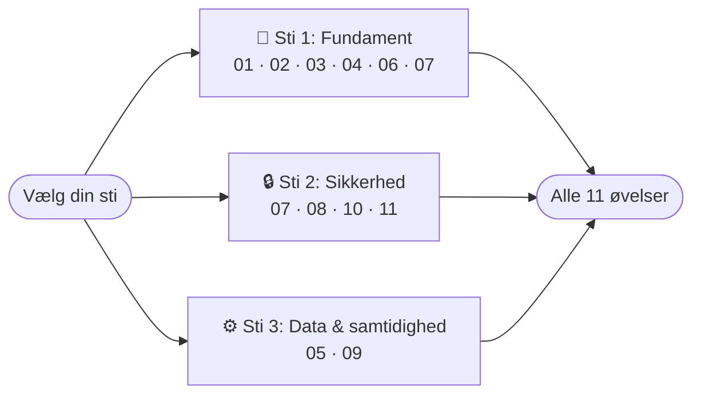

# PostgreSQL sikkerhed - øvelsessamling

En samling af 11 øvelser til undervisning i PostgreSQL-administration, -optimering og -udvikling.

## Du skal bruge
- Docker Desktop eller Podman
- Minimum 8 GB RAM anbefalet

## Øvelser

| Nr | Titel | Niveau | Tid | Docker | Beskrivelse |
|----|-------|--------|-----|--------|-------------|
| 01 | [Benchmarking og hukommelseskonfiguration med pgbench](./oevelser/01-kanariefuglen/OEVELSE.md) | Let | 30-45 min | 🐳 | Performance-tuning med pgbench og konfiguration |
| 02 | [Statistik og ANALYZE til bedre query-planer](./oevelser/02-statistik-er-ikke-et-fyord/OEVELSE.md) | Let | 30 min | 🐳 | ANALYZE og query-planlægning |
| 03 | [Læsning af eksekveringsplaner med EXPLAIN](./oevelser/03-eksekveringsplan/OEVELSE.md) | Let | 45 min | 🐳 | EXPLAIN, seq scan, nested loop, hash join |
| 04 | [Indekser: hurtigere læsning, langsommere skrivning](./oevelser/04-indeksokonomi/OEVELSE.md) | Let | 45 min | 🐳 | Indekser, læse- vs skriveperformance |
| 05 | [Normalisering til 3NF og bevidst denormalisering](./oevelser/05-datamodellering/OEVELSE.md) | Middel | 60 min | 🐳 | Normalisering, denormalisering |
| 06 | [Overvågning af forbindelser og queries med pg_stat_activity](./oevelser/06-pg-stat-activity/OEVELSE.md) | Middel | 45 min | 🐳 | Overvågning af aktive forbindelser |
| 07 | [Logging og audit af databaseaktivitet](./oevelser/07-logging/OEVELSE.md) | Middel | 45 min | 🐳 | PostgreSQL-log, log_statement, fejlfinding |
| 08 | [Brugeradministration og rettigheder](./oevelser/08-roller/OEVELSE.md) | Middel | 45 min | 🐳 | Roller, GRANT/REVOKE, Row Level Security |
| 09 | [Transaktioner, isolation og savepoints](./oevelser/09-transactions/OEVELSE.md) | Middel | 60 min | 🐳 | ACID, isolationsniveauer, to sessioner |
| 10 | [Triggers og audit-log](./oevelser/10-triggers/OEVELSE.md) | Middel | 45 min | 🐳 | Trigger-funktioner, BEFORE/AFTER |
| 11 | [Kryptering med pgcrypto](./oevelser/11-kryptering/OEVELSE.md) | Middel | 45 min | 🐳 | pgp_sym_encrypt, password-hash med crypt |

## 🧭 Læringsstier (ca. 5 timer)

Usikker på hvor du skal starte? Vælg en sti. Detaljer findes i [LEARNING_PATHS.md](./LEARNING_PATHS.md).



| | Sti | Målgruppe | Øvelser | Tid |
|---|-----|-----------|---------|-----|
| 🌱 | [Sti 1: Fundament](./LEARNING_PATHS.md#sti-1-fundament) | Nybegyndere | 01 · 02 · 03 · 04 · 06 · 07 | ~4 t |
| 🔒 | [Sti 2: Sikkerhed](./LEARNING_PATHS.md#sti-2-sikkerhed) | Alle | 07 · 08 · 10 · 11 | ~3 t |
| ⚙️ | [Sti 3: Data & samtidighed](./LEARNING_PATHS.md#sti-3-data--samtidighed) | Udviklere | 05 · 09 | ~2 t |

## Brugsanvisning

### For studerende:

1. **Vælg en øvelse** fra listen ovenfor
2. Naviger til den ønskede øvelsesmappe:
   ```bash
   cd oevelser/01-kanariefuglen
   ```

3. Start øvelsen:
   ```bash
   docker compose up -d
   ```

4. Vent på, at databasen er klar (ca. 10-15 sekunder):
   ```bash
   docker compose exec postgres pg_isready -U studie
   ```
   Forventet output: `postgres:5432 - accepting connections`

5. Koble til databasen:
   ```bash
   docker compose exec postgres psql -U studie -d studiebase
   ```

6. Følg instruktionerne i `OEVELSE.md`

7. **VIGTIGT**: Ryd op efter hver øvelse:
   ```bash
   docker compose down -v
   ```
   Dette fjerner containere, volumener og netværk.

### Der er AI-genererede løsninger for alle opgaver  
- Facit findes i `facit/` mappen
- Hver facit-fil indeholder forventede outputs og svar på refleksionsspørgsmål
- Al data er deterministiske (fast seed), så resultater kan reproduceres

### Generelle tips

- **Alle øvelser** bruger det samme login:
  - Bruger: `studie`
  - Password: `studie`
  - Database: `studiebase`
  - Port: `5432`

- **Port konflikter**: Kør kun én øvelse ad gangen, da alle bruger port 5432

- **Ventetid**: Containerne tager 10-30 sekunder at starte, afhængigt af om Docker images allerede er downloadet

- **Deterministiske data**: Alle seed-scripts bruger `SET seed = 42;` for at sikre reproducerbare resultater

### For øvelser med to sessioner (09, 10, 11):

```bash
# Start to sessioner
./scripts/to-sessioner.sh

# Eller manuelt:
docker compose exec -it postgres psql -U studie -d studiebase &
docker compose exec -it postgres psql -U studie -d studiebase
```

## Fejlfinding

### "Port is already allocated"
**Årsag**: En anden container bruger port 5432
**Løsning**: 
```bash
# Stop den forrige øvelse
cd ../[forrige-oevelse]
docker compose down

# Prøv igen
cd ../[ny-oevelse]
docker compose up -d
```

### "Database does not exist"
**Årsag**: Containeren er ikke færdig med at initialisere
**Løsning**: Vent 10-15 sekunder og prøv:
```bash
docker compose exec postgres pg_isready -U studie
```

### "Connection refused"
**Årsag**: Containeren kører ikke
**Løsning**: Tjek status:
```bash
docker compose ps
```
Hvis containeren ikke kører, start den:
```bash
docker compose start
```

### "Permission denied" på scripts
**Løsning**: Gør scriptet eksekverbart:
```bash
chmod +x scripts/to-sessioner.sh
```

## Docker images brugt

- **PostgreSQL**: `postgres:18` (nyeste stabile version) til de fleste øvelser
- **PostGIS**: `postgis/postgis:18` til øvelse 14 (geo-querys)
- **PgBouncer**: `edoburu/pgbouncer:latest` til øvelse 15 (connection pooling)
- **PostgreSQL 17**: `postgres:17` til øvelse 19 (major upgrade)

## Bidrag og rapportering

- Rapportér fejl i `TESTREPORT.md`
- Alle øvelser er testet med Docker Desktop på macOS, Linux og Windows
- For bedste resultater: 8 GB RAM minimum, 16 GB anbefalet til avancerede øvelser

## Versioner

- PostgreSQL: 18.7
- Docker Compose: v2+
- Sidst opdateret: November 2026

---

*Lavet med kærlighed til databaseundervisning* HAHA
