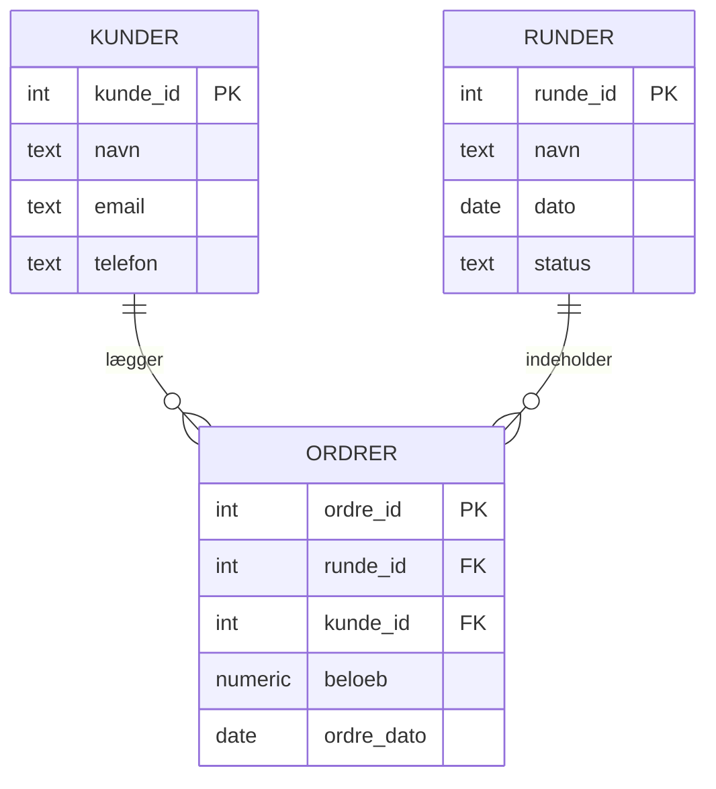

# Øvelse 05: Normalisering til 3NF og bevidst denormalisering

## Diagram



*Det normaliserede 3NF-mål. Øvelsen starter i den denormaliserede tabel, hvor kunde- og rundedata gentages i hver ordre.*

## Formål
At lære at genkende og løse datamodelleringsproblemer. Du vil arbejde med et denormaliseret ordreskema, normalisere det til 3NF, og derefter denormalisere bevidst ét sted for at forbedre performance.

## Forudsætninger
- Docker Desktop eller Podman installeret
- Minimum 4 GB RAM til rådighed for Docker
- Grundlæggende kendskab til SQL, normalformer og datamodellering

## Start

1. Naviger til øvelsens mappe:
   ```bash
   cd oevelser/05-normalization-3nf
   ```

2. Start Postgres-containeren:
   ```bash
   docker compose up -d
   ```

3. Vent på, at databasen er klar:
   ```bash
   docker compose exec postgres pg_isready -U studie
   ```

4. Koble til databasen:
   ```bash
   docker compose exec postgres psql -U studie -d studiebase
   ```

## Opgaver

### 1. Inspektér det denormaliserede skema
Tjek den nuværende struktur:
```sql
\d ordrer_denormaliseret
```

Vis nogle prøvedata:
```sql
SELECT * FROM ordrer_denormaliseret LIMIT 10;
```

**Tjek:** Du skal se et kryptisk skema med:
- Dubletter (f.eks. runde_id, runde_navn, runde_dato gentages for hver ordre)
- Anakronismer (f.eks. runde_dato kan være i fremtiden)
- Redundante data (kunde_info gemmes med hver ordre)

### 2. Identificér problemerne
Kør følgende queries for at identificere problemer:

**a) Find dubletter:**
```sql
SELECT runde_id, runde_navn, count(*) as ordre_count
FROM ordrer_denormaliseret
GROUP BY runde_id, runde_navn
HAVING count(*) > 1;
```

**b) Find inkonsistente data:**
```sql
SELECT runde_id, runde_navn, runde_dato, count(*)
FROM ordrer_denormaliseret
GROUP BY runde_id, runde_navn, runde_dato
HAVING count(*) > 0;
-- Tjek om samme runde_id har forskellige navne/datoer
```

**c) Find redundans:**
```sql
SELECT count(DISTINCT kunde_info) FROM ordrer_denormaliseret;
SELECT count(*) FROM ordrer_denormaliseret;
```
**Tjek:** Antallet af unikke kunde_info bør være langt mindre end total rækker

### 3. Normalisér til 3NF
Opret et no
rmaliseret skema med følgende tabeller:
- `kunder` (kunde_id, navn, email, telefon)
- `runder` (runde_id, navne, dato, status)
- `ordrer` (ordre_id, runde_id, kunde_id, beloeb, ordre_dato, status)
- `ordre_linjer` (linje_id, ordre_id, produkt_id, antal, pris)

**Hint:**
- Ekstraher unikke entiteter til separate tabeller
- Brug fremmednøgler (FOREIGN KEY) til at oprette relationer
- Sikre referentiel integritet

### 4. Migrér data til det normale skema
Flyt data fra `ordrer_denormaliseret` til de nye tabeller:
- Split JSON-felter (kunde_info, runde_info)
- Håndter dubletter (sørg for, at hver runde kun gemmes én gang)
- Opret nøgler og relationer

**Tjek:**
```sql
SELECT count(*) FROM kunder;     -- ~10.000
SELECT count(*) FROM runder;     -- ~100
SELECT count(*) FROM ordrer;     -- ~100.000
SELECT count(*) FROM ordre_linjer; -- ~100.000 (én linje pr. ordre i seed-data)
```

### 5. Validerer normalformen
Tjek at der ikke er:
- **1NF overtrædelser**: Atomerværdier (ingen komma-separerede lister)
- **2NF overtrædelser**: Delvis afhængighed (alle kolonner afhænger af hele primærnøglen)
- **3NF overtrædelser**: Transitiv afhængighed (ingen non-key kolonner afhænger af andre non-key kolonner)

### 6. Denormalisér bevidst
Vælg ÉT sted at denormalisere for at forbedre performance. F.eks.:
- Tilføj `kunde_navn` til `ordrer`-tabelen for at undgå JOIN ved hyppige queries

Opret den denormaliserede kolonne:
```sql
ALTER TABLE ordrer ADD COLUMN kunde_navn VARCHAR(100);
UPDATE ordrer o SET kunde_navn = k.navn FROM kunder k WHERE o.kunde_id = k.kunde_id;
```

Opret en trigger for at vedligeholde denormaliserede data:
```sql
-- Se OEVELSE.md for trigger-eksempel
```

### 7. Sammenlign performance
Mål query-tid med og uden denormalisering:
```sql
\timing on

-- Med JOIN
SELECT o.ordre_id, o.beloeb, k.navn, k.email
FROM ordrer o
JOIN kunder k ON o.kunde_id = k.id
WHERE o.runde_id = 5;

-- Med denormaliseret kolonne
SELECT ordre_id, beloeb, kunde_navn
FROM ordrer 
WHERE runde_id = 5;

```

**Notér:** Tidsforskellen (denormaliseret bør være hurtigere)

### 8. Dokumentér beslutningen
Skriv en kort begrundelse for din denormalisering:
- Hvilken query forbedres?
- Hvad er omkostningen (opdateringskompleksitet)?
- Er det værd at gøre?

## Refleksion

1. Hvilke problemer opstår typisk i denormaliserede skemaer?
2. Hvornår er denormalisering berettiget?
3. Hvilke alternativer til denormalisering kender du (f.eks. materialized views, caching)?

## Det har du lært

- At genkende overtrædelser af normalformer (1NF, 2NF, 3NF)
- At normalisere et denormaliseret skema
- At migrere data til et normaliseret skema
- At denormalisere bevidst for performance
- At bruge triggers til at vedligeholde denormaliserede data
- At afveje fordele og ulemper ved normalisering vs. denormalisering