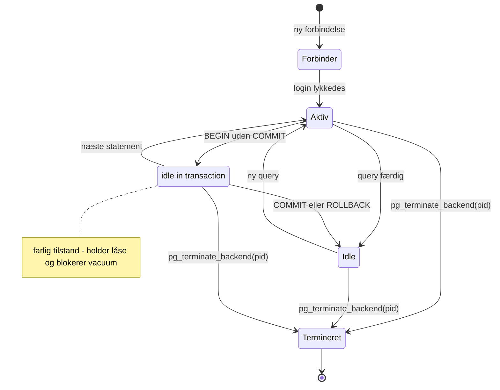

# Øvelse 06: Overvågning af forbindelser og queries med pg_stat_activity

## Diagram



*Forbindelsens livscyklus, som den vises i pg_stat_activity. Øvelsen finder og dræber de problematiske tilstande.*

## Formål
At lære at overvåge aktive databaseforbindelser og identificere problematiske queries. Du vil oprette langkørende queries og idle-in-transaction forbindelser, og derefter finde og dræbe dem.

## Forudsætninger
- Docker Desktop eller Podman installeret
- Minimum 4 GB RAM til rådighed for Docker
- Grundlæggende kendskab til SQL og psql

## Start

1. Naviger til øvelsens mappe:
   ```bash
   cd oevelser/06-pg-stat-activity
   ```

2. Start Postgres-containeren:
   ```bash
   docker compose up -d
   ```

3. Vent på, at databasen er klar:
   ```bash
   docker compose exec postgres pg_isready -U studie
   ```

4. Koble til databasen:
   ```bash
   docker compose exec postgres psql -U studie -d studiebase
   ```

## Opgaver

### 1. Opret testdata
Seed-scriptet opretter automatisk en stor tabel. Verificér:
```sql
SELECT count(*) FROM store_data;
```
**Tjek:** ~500.000 rækker

### 2. Start en langkørende query i baggrunden
I en ny terminal, start en langkørende query:
```bash
# Åbn en ny terminal (hold den gamle åben)
docker compose exec postgres psql -U studie -d studiebase -c "\timing on" -c "SELECT pg_sleep(60);"
```
**Tjek:** Query'en kører i 60 sekunder og blokkerer.

**VIGTIGT:** Skriv IKKE `SELECT pg_sleep(60), * FROM store_data ...` — `pg_sleep()` i SELECT-listen kører én gang **pr. returneret række**, så med tusindvis af rækker ville den køre i timevis!

### 3. Overvåg aktive forbindelser
I den originale psql-session, kør:
```sql
SELECT * FROM pg_stat_activity;
```

**Notér:** 
- `pid`: Process ID
- `usename`: Bruger
- `application_name`: Applikation
- `client_addr`: Klient IP
- `state`: Tilstand (active, idle, idle in transaction)
- `query`: Den kørende query
- `query_start`: Starttidspunkt

**Tjek:** Du skal se din langkørende query med state = 'active'

### 4. Find langkørende queries
```sql
SELECT 
    pid,
    usename,
    application_name,
    state,
    now() - query_start AS duration,
    query
FROM pg_stat_activity
WHERE state = 'active' AND now() - query_start > interval '5 seconds'
ORDER BY duration DESC;
```

**Tjek:** Din langkørende query vises med lang duration

### 5. Start en idle-in-transaction forbindelse
I endnu en ny terminal, start en transaktion og gør ingenting:
```bash
# Åbn en ny terminal
docker compose exec -it postgres psql -U studie -d studiebase
-- I psql:
BEGIN;
-- Vent 10 sekunder uden at commite
```

**Tjek:** I pg_stat_activity vises den som `idle in transaction`

### 6. Find idle-in-transaction forbindelser
```sql
SELECT 
    pid,
    usename,
    state,
    now() - state_change AS idle_duration,
    query
FROM pg_stat_activity
WHERE state = 'idle in transaction'
ORDER BY idle_duration DESC;
```

**Tjek:** Din idle-in-transaction forbindelse vises

### 7. Dræb en langkørende query
Find PID'en og dræb den:
```sql
-- Først: Find PID'en
SELECT pid FROM pg_stat_activity WHERE query LIKE '%pg_sleep%';

-- Så: Dræb den (erstat X med PID)
SELECT pg_terminate_backend(X);
```

**Tjek:** Query'en stopper, og den vises ikke længere i pg_stat_activity

### 8. Dræb en idle-in-transaction forbindelse
Find PID'en for idle-in-transaction forbindelsen:
```sql
SELECT pid FROM pg_stat_activity WHERE state = 'idle in transaction';
```

Dræb den:
```sql
SELECT pg_terminate_backend(Y);  -- Erstat Y med PID
```

**Tjek:** Forbindelsen forsvinder fra pg_stat_activity

### 9. Overvåg blokeringer
Opret en blokeringssituation:

I terminal 1 ( som user studie):
```bash
docker compose exec -it postgres psql -U studie -d studiebase -c "BEGIN; SELECT * FROM store_data WHERE id = 1 FOR UPDATE;"
```

I terminal 2:
```bash
docker compose exec -it postgres psql -U studie -d studiebase -c "SELECT * FROM store_data WHERE id = 1 FOR UPDATE;"
```

Kør i original session:
```sql
SELECT 
    blocked_locks.pid AS blocked_pid,
    blocking_locks.pid AS blocking_pid,
    blocked_activity.usename AS blocked_user,
    blocking_activity.usename AS blocking_user,
    blocked_activity.query AS blocked_statement
FROM pg_catalog.pg_locks blocked_locks
JOIN pg_stat_activity blocked_activity ON blocked_activity.pid = blocked_locks.pid
JOIN pg_catalog.pg_locks blocking_locks 
    ON blocking_locks.locktype = blocked_locks.locktype
    AND blocking_locks.DATABASE IS NOT DISTINCT FROM blocked_locks.DATABASE
    AND blocking_locks.relation IS NOT DISTINCT FROM blocked_locks.relation
    AND blocking_locks.page IS NOT DISTINCT FROM blocked_locks.page
    AND blocking_locks.tuple IS NOT DISTINCT FROM blocked_locks.tuple
    AND blocking_locks.virtualxid IS NOT DISTINCT FROM blocked_locks.virtualxid
    AND blocking_locks.transactionid IS NOT DISTINCT FROM blocked_locks.transactionid
    AND blocking_locks.classid IS NOT DISTINCT FROM blocked_locks.classid
    AND blocking_locks.objid IS NOT DISTINCT FROM blocked_locks.objid
    AND blocking_locks.objsubid IS NOT DISTINCT FROM blocked_locks.objsubid
    AND blocking_locks.pid != blocked_locks.pid
JOIN pg_stat_activity blocking_activity ON blocking_activity.pid = blocking_locks.pid
WHERE NOT blocked_locks.GRANTED;
```

**Tjek:** Du skal se blokeringer mellem de to sessioner

### 10. Opret en monitoring-view
Opret en view til nem overvågning:
```sql
CREATE VIEW aktivitet_overvaagning AS
SELECT 
    pid,
    usename,
    application_name,
    client_addr,
    state,
    now() - query_start AS duration,
    now() - state_change AS state_duration,
    query,
    backend_start,
    xact_start,
    backend_type
FROM pg_stat_activity
WHERE state != 'idle'
ORDER BY 
    CASE WHEN state = 'active' THEN 0 ELSE 1 END,
    duration DESC;
```

Vis viewet:
```sql
SELECT * FROM aktivitet_overvaagning;
```

### 8. Lås-demo med to sessioner: hvem blokerer hvem?
Session A (terminal 1):
```sql
BEGIN;
UPDATE store_data SET numero = numero + 1 WHERE id = 1;  -- tager lås på rækken
-- lad være med at committe
```
Session B (terminal 2):
```sql
UPDATE store_data SET numero = numero + 2 WHERE id = 1;  -- venter nu på låsen
```
I session A (eller en tredje), se hvem der blokerer hvem:
```sql
SELECT a.pid AS blokeret_pid, b.pid AS blokerende_pid, a.query AS blokeret_query
FROM pg_stat_activity a
JOIN pg_stat_activity b ON b.pid = ANY(pg_blocking_pids(a.pid))
WHERE a.state = 'active';
```
**Tjek:** Du kan se både den blokerede og den blokerende session. Rul tilbage i session A (`ROLLBACK;`) — så går session B igennem.

### 9. Find den mistænkelige forbindelse selv
Forestil dig produktion kl. 03: en forbindelse hænger og blokerer andre. Find den:
```sql
SELECT pid, usename, state, now() - state_change AS varighed, left(query, 80) AS query
FROM pg_stat_activity
WHERE datname = 'studiebase' AND pid <> pg_backend_pid()
ORDER BY state_change;
```
Identificer en `idle in transaction`, der holder låse (tjek `pg_locks` for pid'en), og dræb den med `pg_terminate_backend(pid)`.

## Refleksion

1. Hvorfor er idle-in-transaction forbindelser problematiske?
2. Hvornår bør man dræbe en forbindelse, og hvornår bør man lade den være?
3. Hvilke oplysninger i pg_stat_activity er mest nyttige for at diagnosticere problemer?

## Det har du lært

- At bruge pg_stat_activity til at overvåge aktive forbindelser
- At identificere langkørende queries
- At finde og håndtere idle-in-transaction forbindelser
- At dræbe problematiske forbindelser med pg_terminate_backend()
- At detektere blokeringer mellem forbindelser
- At oprette custom monitoring-views
- At forstå de forskellige tilstande (active, idle, idle in transaction)
