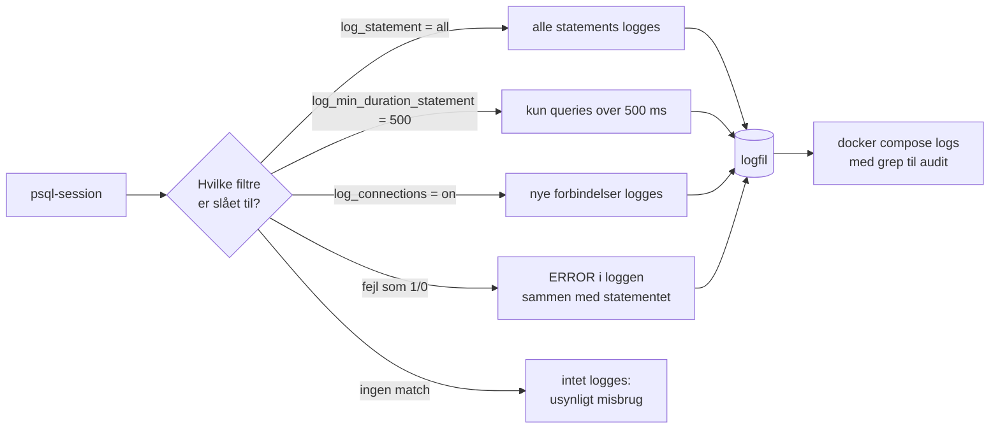

# Øvelse 07: Logging og audit af databaseaktivitet

## Diagram



*Logning er en pipeline af filtre: kun det der matcher en aktiv regel ender i loggen, resten er usynligt.*

## Formål
At lære at slå logning til og fra, læse PostgreSQL-loggen og bruge den til fejlfinding og audit (hvem gjorde hvad, hvornår). Uden logning kan man ikke opdage misbrug bagefter.

## Forudsætninger
- Docker Desktop eller Podman installeret
- Grundlæggende kendskab til SQL og psql

## Start

1. Naviger til øvelsens mappe:
   ```bash
   cd oevelser/07-logging
   ```
2. Start Postgres-containeren:
   ```bash
   docker compose up -d
   ```
3. Vent på, at databasen er klar:
   ```bash
   docker compose exec postgres pg_isready -U studie
   ```
4. Koble til databasen:
   ```bash
   docker compose exec postgres psql -U studie -d studiebase
   ```

## Opgaver

### 1. Se den aktuelle log-konfiguration
```sql
SHOW log_destination;
SHOW log_statement;
SHOW log_min_duration_statement;
SHOW log_connections;
```

### 2. Slå statement-logning til for din session
```sql
SET log_statement = 'all';
SELECT * FROM konto_log;
SELECT * FROM konto_log WHERE beloeb > 1000;
```
Læs loggen uden for psql:
```bash
docker compose logs postgres | tail -20
```
**Tjek:** Du kan se dine egne SELECT-statements i loggen.

### 3. Log kun langsomme queries
```sql
SET log_statement = 'none';
SET log_min_duration_statement = 0;   -- log ALT, også hurtige queries
SELECT pg_sleep(0.05);
```
Sæt derefter `SET log_min_duration_statement = 500;` (ms) og kør en hurtig query — den kommer IKKE i loggen.

### 4. Fremkald en fejl og find den i loggen
```sql
SET log_statement = 'all';
SELECT 1/0;
```
```bash
docker compose logs postgres | grep -i error
```
**Tjek:** Loggen viser `ERROR:  division by zero` sammen med statementet.

### 5. Se forbindelses-logning
Containeren kører med `-c log_connections=on`. Lav en ny forbindelse og tjek loggen:
```bash
docker compose exec postgres psql -U studie -d studiebase -c "SELECT 1;"
docker compose logs postgres | grep -i "connection"
```

### 6. Se alle log-relaterede indstillinger
```sql
SELECT name, setting FROM pg
_settings WHERE name LIKE 'log%' ORDER BY name;
```

## Refleksion

1. Hvorfor vil man IKKE køre med `log_statement = 'all'` i produktion?
2. Hvad er forskellen på `log_statement` og `log_min_duration_statement`?
3. Hvorfor bør logfiler ikke ligge samme sted som dataene, hvis de skal bruges til audit?

## Det har du lært

- At aflæse og ændre log-indstillinger med `SHOW`/`SET`
- At læse loggen via `docker compose logs`
- Forskellen på statement-log, duration-log og forbindelses-log
- At bruge loggen til fejlfinding (errors) og audit (hvem kørte hvad)
