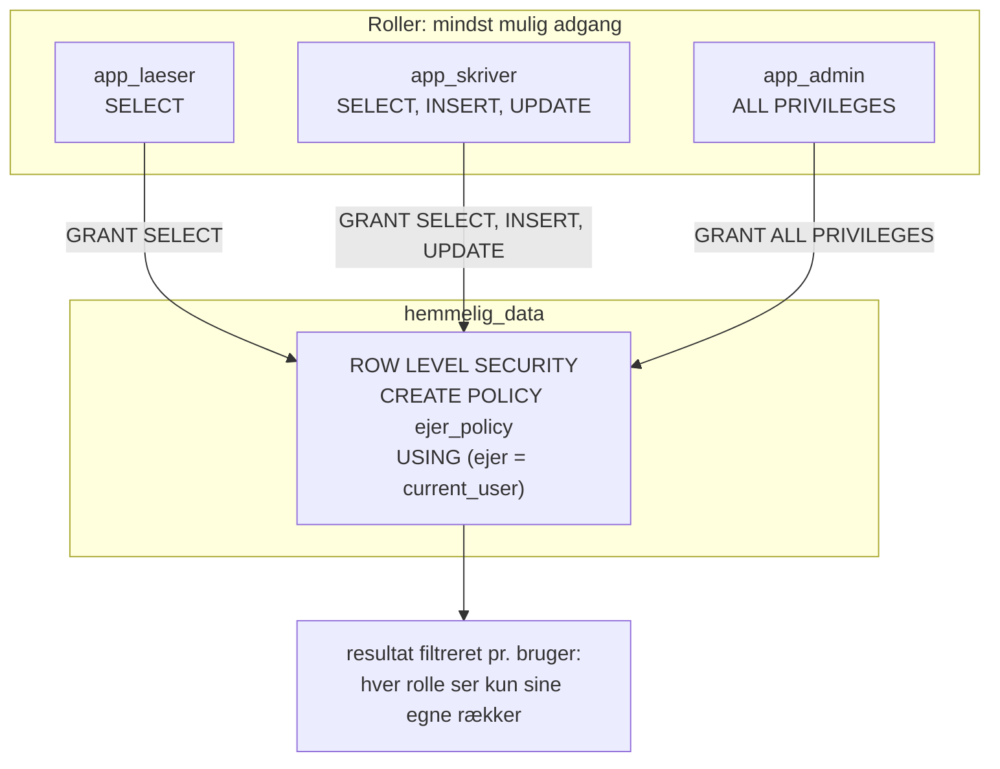

# Øvelse 08: Brugeradministration og rettigheder (roller, GRANT/REVOKE, RLS)

## Diagram



*GRANT/REVOKE styrer hvad hver rolle må, RLS filtrerer rækkerne inden de når brugeren.*

## Formål
At lære at oprette roller, tildele præcis de rettigheder hver rolle skal have (princippet om mindst mulig adgang) og begrænse rækker med Row Level Security.

## Forudsætninger
- Docker Desktop eller Podman installeret
- Grundlæggende kendskab til SQL og psql

## Start

1. `cd oevelser/08-roller`
2. `docker compose up -d`
3. `docker compose exec postgres pg_isready -U studie`
4. `docker compose exec postgres psql -U studie -d studiebase`

## Opgaver

### 1. Se hvilke roller der findes
```sql
SELECT rolname, rolcanlogin, rolsuper FROM pg_roles ORDER BY rolname;
```
**Tjek:** Du ser `studie` (superuser) samt `app_laeser`, `app_skriver`, `app_admin`.

### 2. Giv læserollen adgang til at læse — og kun det
```sql
GRANT USAGE ON SCHEMA public TO app_laeser;
GRANT SELECT ON hemmelig_data TO app_laeser;
```
Test som læser:
```sql
SET ROLE app_laeser;
SELECT * FROM hemmelig_data;   -- virker
INSERT INTO hemmelig_data (navn, hemmelighed, ejer) VALUES ('x','y','z');  -- fejler: permission denied
RESET ROLE;
```

### 3. Giv skriverollen læse+skrive, men ikke delete
```sql
GRANT SELECT, INSERT, UPDATE ON hemmelig_data TO app_skriver;
GRANT USAGE, SELECT ON SEQUENCE hemmelig_data_id_seq TO app_skriver;
```
Test med `SET ROLE app_skriver;` — INSERT virker, DELETE fejler.

### 4. Giv admin alle rettigheder på tabellen
```sql
GRANT ALL PRIVILEGES ON hemmelig_data TO app_admin;
```

### 5. Tag en rettighed væk igen (REVOKE)
```sql
REVOKE UPDATE ON hemmelig_data FROM app_skriver;
```
Test igen med `SET ROLE app_skriver;` — UPDATE fejler nu.

### 6. Row Level Security: hver må kun se egne rækker
```sql
ALTER TABLE hemmelig_data ENABLE ROW LEVEL SECURITY;
CREATE POLICY ejer_policy ON hemmelig_data
    USING (ejer = current_user);
```
Positiv test (SET ROLE er OK til hurtig test):
```sql
SET ROLE app_laeser;
SELECT * FROM hemmelig_data;   -- ser KUN sine egne 2 rækker (ejer='app_laeser'), ikke andres
R
ESET ROLE;
```

### 6b. Test med en RIGTIG forbindelse som app_laeser (ikke kun SET ROLE)
```bash
# fra hosten (psql installeret) — password står i init.sql
PGPASSWORD=laeser123 psql -h localhost -p 5432 -U app_laeser -d studiebase -c "SELECT navn, ejer FROM hemmelig_data;"
# prøv at skrive:
PGPASSWORD=laeser123 psql -h localhost -U app_laeser -d studiebase -c "INSERT INTO hemmelig_data (navn, hemmelighed, ejer) VALUES ('x','y','z');"
```
**Tjek:** SELECT viser kun app_laesers egne rækker (RLS); INSERT fejler med `permission denied` (mangler tabel-privilegium).

### 6c. Superbruger og RLS
```sql
SELECT * FROM hemmelig_data;  -- som studie (superuser): ser ALLE rækker — superusers omgår RLS
ALTER TABLE hemmelig_data FORCE ROW LEVEL SECURITY;  -- tvinger RLS også for ejeren/superuser
```

### 7. Se hvad hver rolle må på tabellen
```sql
SELECT grantee, privilege_type FROM information_schema.role_table_grants
WHERE table_name = 'hemmelig_data' ORDER BY grantee, privilege_type;
```

## Refleksion

0. Tabelprivilegier (GRANT) bestemmer HVAD en rolle må (SELECT/INSERT...), RLS bestemmer HVILKE rækker — og en superuser omgår RLS, medmindre tabellen har `FORCE ROW LEVEL SECURITY`.
1. Hvorfor er "mindst mulig adgang" (least privilege) vigtigt?
2. Hvad er forskellen på `GRANT ... TO rolle` og `SET ROLE`?
3. Hvornår er Row Level Security bedre end et almindeligt view?

## Det har du lært

- At oprette login-roller og inspicere dem i `pg_roles`
- `GRANT`/`REVOKE` på tabel- og sekvensniveau
- At teste rettigheder med `SET ROLE` uden ny forbindelse
- Row Level Security med policies
