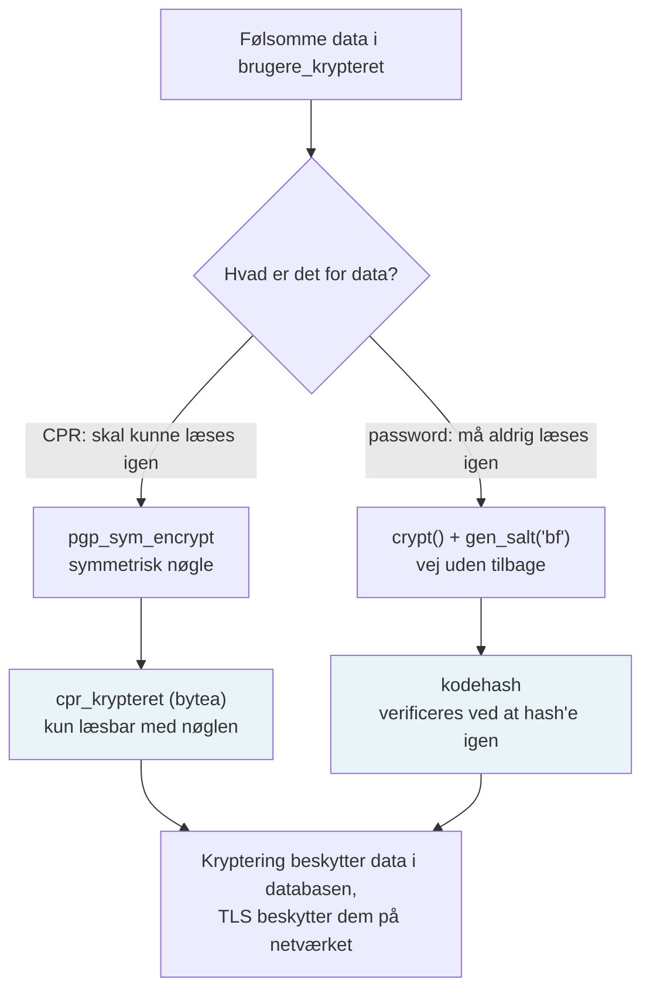

# Øvelse 11: Kryptering med pgcrypto

## Diagram



*Kryptering er reversibel med nøglen, et hash er en vej uden tilbage. Ingen af delerne erstatter TLS.*

## Formål
At lære forskellen på at kryptere følsomme felter i databasen (pgp_sym_encrypt) og at gemme passwords som envvejshash (crypt) — og at forstå, at kryptering i databasen ikke erstatter TLS på netværket.

## Forudsætninger
- Docker Desktop eller Podman installeret
- Grundlæggende kendskab til SQL og psql

## Start

1. `cd oevelser/11-kryptering`
2. `docker compose up -d`
3. `docker compose exec postgres pg_isready -U studie`
4. `docker compose exec postgres psql -U studie -d studiebase`

## Opgaver

### 1. Bekræft at pgcrypto er installeret
```sql
SELECT extname, extversion FROM pg_extension WHERE extname = 'pgcrypto';
```
**Tjek:** rækken viser pgcrypto (følger med i postgres:18-imagen).

### 2. Se at CPR er krypteret i tabellen
```sql
SELECT brugernavn, cpr_krypteret FROM brugere_krypteret LIMIT 3;
```
**Tjek:** `cpr_krypteret` er binær (bytea), ikke læsbar tekst.

### 3. Dekrypter med nøglen
```sql
SELECT brugernavn, pgp_sym_decrypt(cpr_krypteret, 'hemmelig-nøgle') AS cpr
FROM brugere_krypteret LIMIT 3;
```
**Tjek:** CPR vises som klartekst — kun når man har nøglen.

### 4. Forsøg med forkert nøgle
```sql
SELECT pgp_sym_decrypt(cpr_krypteret, 'forkert-nøgle') FROM brugere_krypteret LIMIT 1;
```
**Tjek:** fejler med "Wrong key or corrupt data".

### 5. Passwords skal hashes, ikke krypteres
```sql
SELECT kodehash FROM brugere_krypteret WHERE brugernavn = 'bruger1';
SELECT crypt('kode1', kodehash) = kodehash AS korrekt_kode
FROM brugere_krypteret WHERE brugernavn = 'bruger1';
```
**Tjek:** `korrekt_kode` er true. Et hash kan tjekkes, men ikke læses tilbage.

### 6. Hvorfor kan man ikke søge direkte på krypterede felter?
```sql
SELECT count(*) FROM brugere_krypteret
WHERE pgp_sym_decrypt(cpr_krypteret, 'hemmelig-nøgle') = '010190-0001';
```
Fungerer, men er langsomt (ingen indeks kan bruges på klarteksten). Overvej en separat hash-kolonne til opslag.

## Refleksion

1. Hvor gemmer man helst krypteringsnøglen — i databasen 
eller udenfor?
2. Hvad beskytter kryptering i databasen imod, og hvad beskytter den IKKE imod?
3. Hvad mangler stadig, hvis databasen lækker: TLS på forbindelsen?

## Det har du lært

- `CREATE EXTENSION pgcrypto`
- `pgp_sym_encrypt`/`pgp_sym_decrypt` til følsomme felter (symmetrisk nøgle)
- `crypt()` + `gen_salt('bf')` til sikre password-hashes
- At krypterede felter ikke kan indekseres/søges direkte
