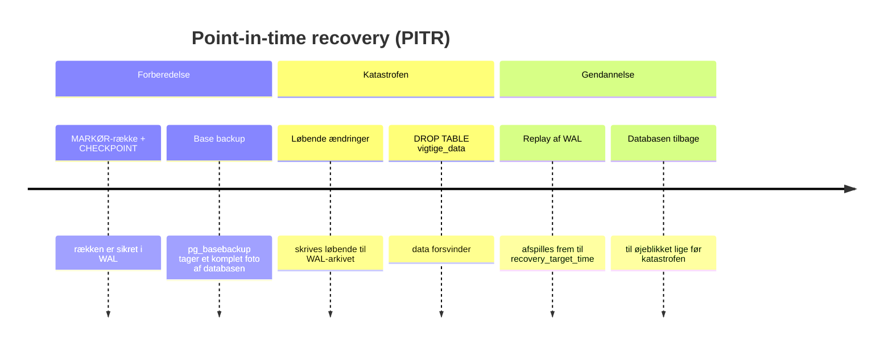

# Øvelse 12: Backup og point-in-time recovery (PITR)

## Diagram



*Base backup er fotoet, WAL-arkivet er videobåndet, recovery_target_time er spoleknappen.*

## Formål
At lære forskellen på logisk backup (pg_dump/pg_restore) og fysisk backup (pg_basebackup + WAL-arkivering), og at gendanne en database til et præcist tidspunkt efter en "katastrofe". En backup, der aldrig er testet, er ingen backup.

## Forudsætninger
- Docker Desktop eller Podman installeret
- Grundlæggende kendskab til SQL, psql og terminalen

## Start

1. `cd oevelser/12-backup-pitr`
2. `docker compose up -d`
3. `docker compose exec postgres pg_isready -U studie`
4. `docker compose exec postgres psql -U studie -d studiebase`

Containeren kører med `wal_level=replica` og `archive_mode=on`; WAL-filer arkiveres til `./archive/` (bind mount, overlever `docker compose down -v`).

## Opgaver

### 1. Bekræft at WAL-arkivering virker
```sql
SHOW wal_level;
SHOW archive_mode;
CHECKPOINT;
SELECT archived_count, last_archived_wal, failed_count FROM pg_stat_archiver;
```
```bash
docker compose exec postgres ls /var/lib/postgresql/archive | head
```
**Tjek:** `archived_count` > 0 og der ligger WAL-filer i `archive/`.

### 2. Logisk backup med pg_dump
```bash
docker compose exec postgres pg_dump -U studie -Fc studiebase > backup/logisk.dump
ls -la backup/
```
"Katastrofe": `DROP TABLE vigtige_data;` i psql. Gendan i en NY database:
```bash
docker compose exec postgres createdb -U studie gendannelse
docker compose exec -T postgres pg_restore -U studie -d gendannelse --no-owner backup/logisk.dump 2>/dev/null || \
  docker compose exec -T postgres pg_restore -U studie -d gendannelse backup/logisk.dump
docker compose exec postgres psql -U studie -d gendannelse -c "SELECT count(*) FROM vigtige_data;"
```
**Tjek:** 100 rækker i `gendannelse.vigtige_data`. Ryd op: `DROP DATABASE gendannelse;`

### 3. Markér tidspunktet FØR katastrofen
```sql
INSERT INTO vigtige_data (tekst) VALUES ('MARKØR før katastrofe');
CHECKPOINT;   -- sikrer at MARKØR-rækken er i WAL
SELECT now() AS tidspunkt, pg_current_wal_lsn() AS lsn;
```
Gem t
idspunktet — det skal bruges som `recovery_target_time` i opgave 6. Kronologien er vigtig: **først** markør + CHECKPOINT, **så** base backup, **så** ændringer, **så** katastrofen.

### 4. Tag fysisk base backup med pg_basebackup
```bash
docker compose exec postgres pg_basebackup -U studie -D /backup -Ft -z -X stream -P
ls -la backup/
```
**Tjek:** `backup/base.tar.gz` (og evt. `pg_wal.tar.gz`) ligger i `backup/`.

### 5. Simulér katastrofen (EFTER backuppet)
```sql
INSERT INTO vigtige_data (tekst) SELECT 'EFTER katastrofe ' || i FROM generate_series(1, 50) AS i;
DROP TABLE vigtige_data;
CHECKPOINT;
```
Tabellen er væk i hovedcontaineren.

### 6. Gendan til tidspunktet med PITR i en ny container (port 5433)
```bash
./scripts/pitr-restore.sh "<TIDSPUNKT FRA Opgave 3>"
sleep 5
docker exec oevelse12-pitr psql -U studie -d studiebase -c "SELECT count(*), max(tekst) FROM vigtige_data;"
```
**Tjek:** 101 rækker (100 før backup + MARKØR), og ingen "EFTER katastrofe"-rækker. Verificér eksplicit:
```bash
docker exec oevelse12-pitr psql -U studie -d studiebase -c "SELECT count(*) AS total, count(*) FILTER (WHERE tekst LIKE 'EFTER%') AS efter FROM vigtige_data;"
# forvent: total=101, efter=0
```
Ryd op: `docker rm -f oevelse12-pitr && rm -rf restore_data`

> **Bemærk om filer og rettigheder:** `archive/` og `backup/` er bind mounts ejet af din host-bruger og overlever `docker compose down -v` (kun `pgdata` slettes). Inde i containeren læses de af postgres-brugeren (uid 999) — tjek med `docker compose exec postgres ls -la /var/lib/postgresql/archive`. `recovery_target_time` skal ligge efter base backuppet er færdigt, ellers fejler recovery — brug tidspunktet fra opgave 3.
>
> I hovedcontaineren er `vigtige_data` stadig droppet efter "katastrofen" — brug ikke den container videre; gendannelsen sker i PITR-containeren på port 5433.

### 7. Sammenlign: logisk vs. fysisk backup
| | pg_dump (logisk) | pg_basebackup + WAL (fysisk) |
|---|---|---|
| Gendanner | én database/tabel | hele
 clusteret |
| PITR | nej | ja (recovery_target_time) |
| Portabilitet | mellem versioner | samme major version |

## Refleksion

1. Hvorfor skal man teste restore, ikke kun backup?
2. Hvad er RPO, og hvordan påvirker WAL-arkivering det?
3. Hvornår vælger man logisk backup frem for fysisk?

## Det har du lært

- `wal_level=replica` + `archive_mode=on` + `archive_command` til WAL-arkivering
- `pg_stat_archiver` til at overvåge arkivering
- `pg_dump -Fc` / `pg_restore` til logisk backup
- `pg_basebackup -Ft -z -X stream` til fysisk backup
- PITR med `recovery.signal`, `restore_command` og `recovery_target_time`
