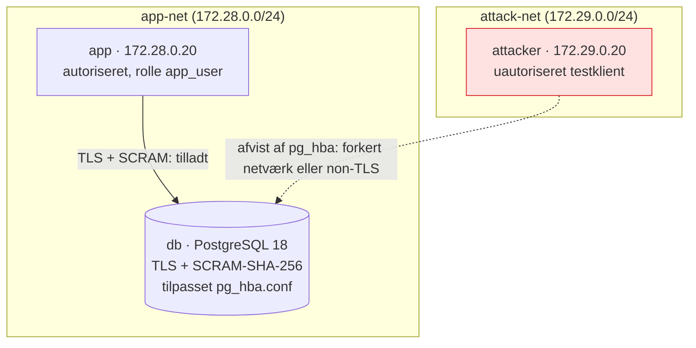

# Øvelse 13: PostgreSQL Hardening — Network Access, Authentication, TLS & Secrets

**Tier 3 · Ekspert · ca. 60-90 min**

## Diagram



*Adgangsmodellen i labbet: app-net er tilladt med TLS og SCRAM, alt andet afvises af pg_hba, hvor første match vinder.*

## Formål
At samle hele sikkerhedsfladen i én hands-on øvelse: forstå adgangsmodellen, begrænse netværksadgang i et isoleret Docker-lab, sætte SCRAM-SHA-256 op, kræve TLS, håndtere secrets sikkert — og til sidst selv hardene en bevidst usikker konfiguration.

## Forudsætninger
- Docker Desktop eller Podman
- `openssl` og `psql` på hosten (macOS/Linux har det; Windows: WSL eller Git Bash)
- Grundlæggende SQL

## Lab-oversigt
`docker-compose.yml` starter tre containere på to isolerede netværk:

| Container | Netværk | IP | Rolle |
|---|---|---|---|
| `db` | app-net + attack-net | 172.28.0.10 / 172.29.0.10 | PostgreSQL 18, TLS på, custom pg_hba |
| `app` | app-net | 172.28.0.20 | autoriseret applikationsservice (rolle `app_user`) |
| `attacker` | attack-net | 172.29.0.20 | uautoriseret testklient |

Port 5432 publiseres kun på `127.0.0.1` på hosten.

## Start
```bash
cd oevelser/13-tls-secrets
./scripts/setup.sh          # laver certs/ og secrets/ (i .gitignore)
docker compose up -d
./scripts/test-connections.sh   # kører Del B's 4 tests (forvent 4 PASS)
```

---

## Del A: Forstå adgangsmodellen (10 min)

Kør i db-containeren (`docker compose exec db psql -U admin -d appdb`) — brug `SHOW`, ikke gæt på stier:

```sql
SHOW listen_addresses;    -- '*' (lytter på alle interfaces — begrænses via pg_hba/netværk)
SHOW hba_file;            -- vores monterede /etc/postgresql/pg_hba.conf
SHOW data_directory;
SHOW password_encryption; -- scram-sha-256 (standard i PG 18)
SHOW ssl;                 -- on
```

Læs `pg_hba.conf` i repo-mappen. Husk:
- **Første match vinder** — rækkefølgen er afgørende.
- `local` = Unix-socket, `host` = TCP (SSL eller ej), `hostssl` = kun TLS, `hostnossl` = kun uden TLS.
- Regler kan begrænse på IPv4/IPv6-adresser/CIDR (vores lab: `172.28.0.0/24` tilladt, resten afvises).
- Roller med `LOGIN` + password er adgangs"nøgler": `SELECT r
olname, rolcanlogin FROM pg_roles;`
- `sslmode` på klienten: `require` (krypteret, ingen cert-tjek) vs `verify-ca`/`verify-full` (tjekker også serverens certifikat/kæde).

## Del B: Begræns netværksadgang (15 min)

`pg_hba.conf` tillader kun `172.28.0.0/24` (app-net) med TLS + SCRAM, plus hostens gateway `172.28.0.1` — alt andet (inkl. attack-net `172.29.0.0/24` og alle non-TLS) afvises.

Kør testen og bekræft alle fire:
```bash
./scripts/test-connections.sh
```
1. app fra app-net med TLS + korrekt password → **accepteres**
2. attacker fra attack-net → **afvises** (`no pg_hba.conf entry`)
3. forkert password → **afvises** (SCRAM-fejl)
4. `sslmode=disable` → **afvises** (`SSL off`)

> Bemærk: Fordi `attacker` sidder på et andet subnet (172.29.x), er testen ikke misvisende — kilde-IP'en er faktisk forskellig, ikke bare docker-gatewayen.

## Del C: SCRAM-SHA-256 autentifikation (15 min)

```sql
SHOW password_encryption;   -- scram-sha-256
-- Tjek at app_user's gemte verifier ER en SCRAM-verifier — uden at udskrive den:
SELECT rolname, rolpassword LIKE 'SCRAM-SHA-256$%' AS er_scram FROM pg_authid WHERE rolname = 'app_user';
-- forvent: er_scram = t
```

- Opret en ny bruger og sæt password: `CREATE ROLE test_user LOGIN PASSWORD 'Test1234!';` — tjek igen at verifieren er `SCRAM-SHA-256$...`.
- Test korrekt vs forkert password fra `app`-containeren (som i Del B).
- **Vigtigt:** `password_encryption` bestemmer kun formatet ved NÆSTE password-ændring — ændrer du indstillingen, migreres eksisterende passwords IKKE automatisk. Migrer med `ALTER ROLE ... PASSWORD 'samme-klartekst'` igen (eller lad brugerne skifte).
- Aldrig udskriv `pg_authid.rolpassword` i dokumentation/screenshots.

## Del D: TLS og certifikater (15 min)

TLS er slået til i compose (`ssl=on` + certs fra `setup.sh`).

```bash
# fra hosten, TLS krævet:
PGPASSWORD=$(cat secrets/db_password.txt) psql "host=localhost dbname=appdb user=admin sslmode=require" -c "SELECT ssl, version FROM pg_stat_ssl WHERE pid = pg_
backend_pid();"
# forvent: ssl = t, version = TLSv1.3

# fuld certifikat-validering (vores self-signed cert er også "root"):
PGPASSWORD=$(cat secrets/db_password.txt) psql "host=localhost dbname=appdb user=admin sslmode=verify-full sslrootcert=certs/server.crt" -c "SELECT 1;"

# uden TLS afvises (Del B test 4).
```

**Forklar:** `sslmode=require` krypterer trafikken, men beviser ikke hvem serveren er (enhver kan præsentere et certifikat). `verify-ca`/`verify-full` tjekker certifikatet mod en trusted CA (og ved verify-full også hostname) — det er det, der forhindrer MITM. Kryptering alene beviser altså ikke identitet.

## Del E: Secrets og rotation (15 min)

- Ingen passwords i compose: admin bruger `POSTGRES_PASSWORD_FILE` (Docker secret), app får sit i `secrets/app_password.txt`. Tjek: `grep -ri password docker-compose.yml` viser kun `_FILE`/secret-navne. `certs/` og `secrets/` er i `.gitignore` — `git status` må ikke vise dem.
- **Rotation uden datatab** (ikke `down -v`!):
```sql
ALTER ROLE app_user PASSWORD 'nyt-lab-password-456';
```
  Opdater `secrets/app_password.txt` med det samme, kør `./scripts/test-connections.sh` igen → test 1 PASS (nyt password virker), og gammelt password giver FAIL (test 3's princip).
- Lab vs produktion: en lokal secret-fil er bedre end hardcoded, men i produktion bruger man Vault/KMS/etc. med rotation og adgangslog.

## Del F: Selvstændig hardening-opgave (20-30 min)

I `challenge/` ligger en bevidst usikker PostgreSQL (`docker compose -f challenge/docker-compose.yml up -d`). Den har **tre sikkerhedsproblemer** — find dem uden fulde trin (gradvise hints i `challenge/HINTS.md`).

Du skal:
1. Identificere problemerne (hint: kig på `pg_hba.conf`, roller og `SHOW ssl`).
2. Implementere forbedringer (pg_hba, roller/REVOKE, TLS, logging).
3. Vise positive OG negative forbindelsestests.
4. Begrunde dine valg og beskrive én tilbageværende risiko.

## Refleksion
1. Hvorfor er "første match vinder" i pg_hba vigtig at forstå, før man ændrer nog
et?
2. Hvad beskytter TLS, og hvad beskytter det ikke?
3. Hvorfor ruller `password_encryption` ikke eksisterende passwords?

## Det har du lært
- Adgangsmodellen: `listen_addresses`, `pg_hba.conf` (first-match), local/host/hostssl/hostnossl, CIDR
- Netværksbegrænsning i isoleret Docker-lab med adskilte subnets
- SCRAM-SHA-256 verifiers i `pg_authid` og hvorfor `password_encryption` ikke migrerer
- TLS: `require` vs `verify-ca`/`verify-full`, `pg_stat_ssl`, kryptering ≠ identitet
- Secrets via Docker secrets + .gitignore, rotation via `ALTER ROLE` uden datatab
